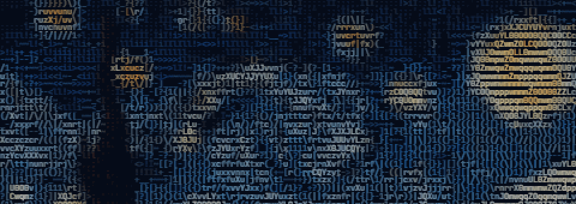
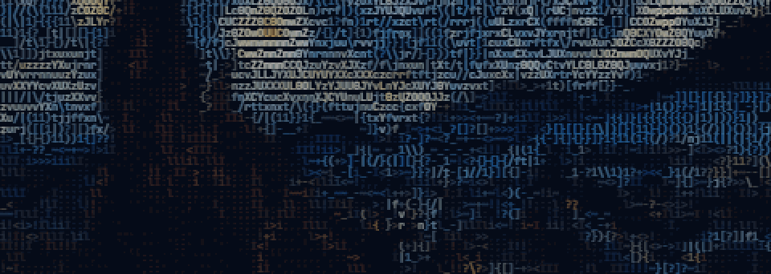

  

<h1 align="center">Waldan Zubary</h1>

Just a Fish.

  <a href="https://www.waldan.my.id">Blog</a> &middot;
  <a href="https://github.com/waldanzubary">GitHub</a> &middot;
  <a href="https://asciimotion.waldan.my.id/">ASCII Motion</a>

---

## Featured project

### ASCII Motion

A browser-based studio for turning videos, GIFs, and photos into animated color ASCII art. Render locally, export, and publish to a public archive.

[Live](https://asciimotion.waldan.my.id/) | [Studio](https://asciimotion.waldan.my.id/studio) | [Archive](https://asciimotion.waldan.my.id/#archive)

---

  
Latest notes &amp; commits

   

  <!-- UPDATES:START -->
  | # | Blog | Latest Commit |
  |---:|---|---|
  | 01 | [Membuat README GitHub WebP Animated: Laut Waldan yang Hidup](https://www.waldan.my.id/blog/membuat-readme-webp-animated) | [waldanzubary/animated-ascii — feat: animated ASCII studio with Cloudflare Workers deployment](https://github.com/waldanzubary/animated-ascii/commit/4d24e830863170005afc938849dc52f0009250a8) |
  | 02 |  | [waldanzubary/auto-commit — 🤖 Auto update: 2026-11-15 08:44:55 WIB (loop 3/3)](https://github.com/waldanzubary/auto-commit/commit/d0df9287725c377881db65f98091abc205ac189b) |
  | 03 |  | [waldanzubary/auto-commit — 🤖 Auto update: 2026-11-15 08:43:23 WIB (loop 2/3)](https://github.com/waldanzubary/auto-commit/commit/9c9c1c10b9c19b9377754a48d78caa6083439213) |
  | 04 |  | [waldanzubary/auto-commit — 🤖 Auto update: 2026-11-15 08:41:52 WIB (loop 1/3)](https://github.com/waldanzubary/auto-commit/commit/a822e855469c89e2c5c8f3d89c02df214ea8c0c6) |
  | 05 |  | [waldanzubary/fish-os — feat: readable paste slugs and scrollable paste pages](https://github.com/waldanzubary/fish-os/commit/098d90f3d7beca91b15d3c553e1e4c56b080b67b) |
  | 06 |  | [waldanzubary/waldanzubary — Update README.md](https://github.com/waldanzubary/waldanzubary/commit/8ee1dcd859d5d12f1606c5e48ca4048e464bc2de) |
  | 07 |  | [waldanzubary/waldanzubary — fix: include latest seven commits](https://github.com/waldanzubary/waldanzubary/commit/ff73f070d179c013fd34c9def24dca66a1938e0a) |
  <!-- UPDATES:END -->

  
Live GitHub sea

   

  <!-- FISH:START -->
  

    <picture>
      <source type="image/webp" srcset="https://raw.githubusercontent.com/waldanzubary/waldanzubary/main/assets/fish.webp?v=20261123-0-360">
      
    </picture>
  

  <!-- FISH:END -->

  

