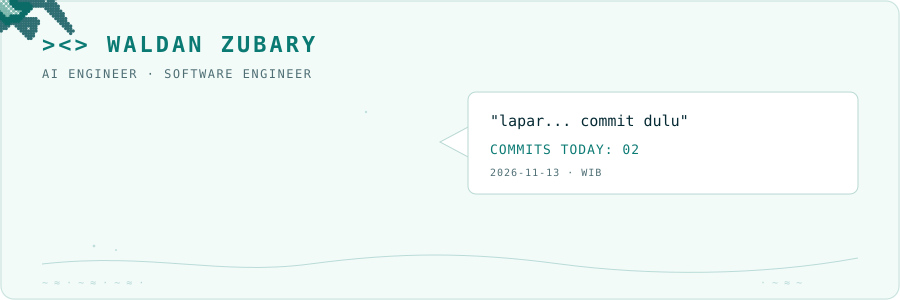

<!-- FISH:START -->
<p align="center">
  <picture>
    <source media="(prefers-color-scheme: dark)" srcset="https://raw.githubusercontent.com/waldanzubary/waldanzubary/main/assets/fish-dark.svg?v=20261113-0">
    <source media="(prefers-color-scheme: light)" srcset="https://raw.githubusercontent.com/waldanzubary/waldanzubary/main/assets/fish-light.svg?v=20261113-0">
    
  </picture>
</p>
<!-- FISH:END -->

```text
> waldan@deep-sea:~$ whoami
Waldan Zubary
AI Engineer · Software Engineer
```

I build software, AI experiments, and small tools that make everyday work a little
less noisy. This profile keeps a fish fed with today's commits.

```text
> status
mode     : building, learning, shipping
timezone : Asia/Jakarta (UTC+7)
fuel     : commits
```

## > stack

```text
JavaScript  TypeScript  Python  Java  Go  PHP  SQL
HTML        CSS         Git     GitHub  Docker  Postman
```

## > selected work

- [Projects](https://www.waldan.my.id/projects)
- [Notes / blog](https://www.waldan.my.id/blog)
- [Portfolio](https://www.waldan.my.id)

## > elsewhere

```text
website : https://www.waldan.my.id
github  : https://github.com/waldanzubary
email   : waldanz321@gmail.com
```

<p align="center">
  <sub>the fish updates every 3 hours · commits are counted for the current day in WIB</sub>
</p>
